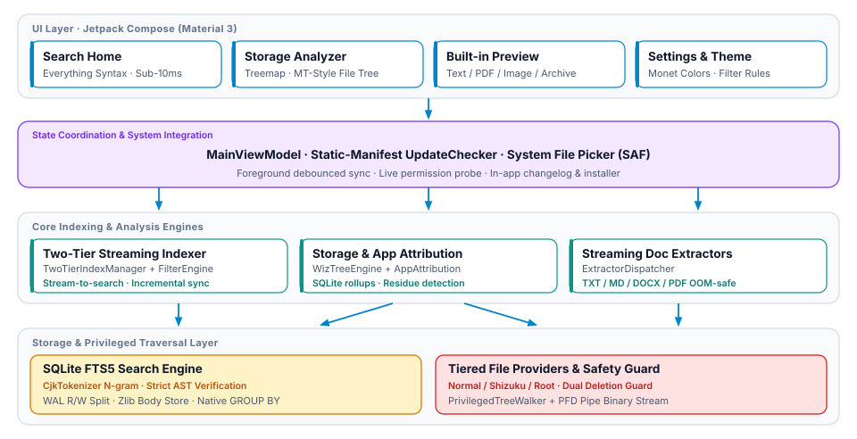

<div align="center">

# Pinpoint

**Offline Full-Disk File & Document Content Search Engine for Android**

Desktop *Everything*-style query syntax · Sub-10 ms CJK substring retrieval over SQLite FTS5 · Tiered `Normal` / `Shizuku` / `Root` access

<p>
  <a href="https://github.com/yyzmia1/Pinpoint/releases"></a>
  <a href="LICENSE"></a>
  
  
  
</p>

<p>
  <strong>English</strong> · <a href="README.md">简体中文</a>
</p>

</div>

---

## v1.6.3 Update

- **Compact settings header**: Only the Pinpoint version/check row and update channel appear at the top. Channels are ordered Stable → Include beta → Off; changelog and open-source details remain at the bottom.
- **Keep indexes across modes**: Settings → Access mode adds “Clear index when switching modes” (off by default) and “Show records retained from other modes” (on by default). Reuse Root records and extracted text after switching to Shizuku or Normal; visibility applies to search, document pickers, and Storage Analyzer. Index cleanup never deletes files from disk.
- **Combined directory lists**: Settings → Directory rules offers an allowlist (empty means unrestricted) and a blocklist, which always takes precedence. Existing exclusions migrate unchanged. Root `/data` scope, cache filtering, and system protections still apply; document extraction scope further narrows the selected directories.
- **Origin-based transitions**: Storage Analyzer and Settings expand from their toolbar icons and contract on return. Day/night changes spread from an upright sun/moon icon; the Settings gear rotates briefly as the page opens. Transitions preserve page position, and respect the system animation setting.

---

## Highlights

- **Offline, *Everything*-Grade Search**: Indexes filenames, paths, and document bodies fully offline; supports boolean operators, wildcards, regex, field qualifiers, size/date filters, and millisecond arbitrary CJK substring recall with zero false positives.
- **Tiered Access (`Normal` / `Shizuku` / `Root`)**:
  - **Normal**: Standard storage traversal via `MANAGE_EXTERNAL_STORAGE`.
  - **Shizuku**: Non-root penetration into `/Android/data` and `/Android/obb` with an interactive 3-step live wizard.
  - **Root**: Full `/` traversal with scoped `/data` controls, symlink safety, virtual-FS exclusions, and bind-mount deduplication.
- **Three-Stage Seamless Incremental Sync & Parallel `lstat`**:
  - **Stage 1 (`< 1s` Hot Storage Sync)**: Verifies `/storage/...` user storage and top 1,000 recently modified docs immediately on foreground resume or system picker open;
  - **Stage 2 (Background `/data` Sync)**: Seamlessly continues verifying `/data/...` in the background without blocking search or preview;
  - **Stage 3 (Reboot / Manual `/` Verification)**: Automatically detects device reboots via `Settings.Global.BOOT_COUNT` (e.g., after installing Root modules or OTA updates) or manual incremental sync to verify remaining `/` partitions (`/system`, `/vendor`, `/mnt`, etc.), accelerated by 4-thread parallel `Os.lstat`.
- **Storage Analyzer with Persistent SQLite Cache**: Persists directory, extension, and app attribution rollups into materialized SQLite `analyzer_*` tables for `< 10ms` cold opens and `< 2MB` constant JVM heap even on 400GB+ Root indexes; includes an interactive treemap, MT-style single-column tree (4-way asc/desc sort, folders-first, `..` parent row), mode-aware top shortcut pills (`/` leftmost + auto-detected module directory in Root mode), unified `/` mount tree, and uninstalled app residue detection.
- **Cross-Permission Safe Deletion from Home & Analyzer**: Long-press any home search result or analyzer entry to permanently delete across Normal / Shizuku / Root without following symlinks (`DeletionSafetyGuard` enforced on both UI and Binder), with O(depth) real-time cache deduction.
- **Built-in Preview & System File Picker**: In-app preview for text/code, PDFs, zoomable images, archives, and media, plus SAF & `ACTION_GET_CONTENT` picker integration for external apps.
- **Material You UI, Rate-Limit-Free Updates & GPLv3**: Monet dynamic colors, AMOLED pure-black dark mode, clean bottom-consolidated Settings updater backed by static `release-manifest` mirrors, and GNU GPLv3 open-source license.

---

## Screenshots & Demo


---

## Installation & Usage

### Download & Requirements

- **Download**: Grab the latest signed `app-release.apk` from [Releases](https://github.com/yyzmia1/Pinpoint/releases) (package ID `com.yyzm.pinpoint`; an optional side-by-side debug build `app-debug.apk` with ID `com.yyzm.pinpoint.debug` is also published).
- **Requirements**: Android 8.0 (API 26) or higher, targeting Android 15 (API 35).
- **Legacy Package Migration**: If you previously installed `<= v1.2.1` (legacy package ID `com.pocketeverything.app`), manually uninstall the older app before installing newer builds to avoid duplicate launcher icons.

### First Launch & Permission Modes

| Access Mode | Scope | Setup Path |
| :--- | :--- | :--- |
| **Normal** | Primary & removable shared storage | Launch Pinpoint and tap **Grant** → enable **All Files Access** (`MANAGE_EXTERNAL_STORAGE`) in system settings → return to auto-build the index. |
| **Shizuku** | Non-root penetration into `/Android/data` & `/Android/obb` | Start the [Shizuku](https://shizuku.rikka.app/) service → tap the mode pill in the top bar and select **Shizuku** → follow the built-in 3-step wizard to authorize and index. |
| **Root** | Full `/` traversal & scoped `/data` indexing | Tap the top-bar mode pill and select **Root** → grant superuser permission in Magisk / KernelSU / APatch → optionally allow `/data` subdirectories under **Settings → Scope & Exclusions**. |

### Advanced Usage

- **Query Syntax**: Supports desktop *Everything*-style boolean operators, wildcards, regex, field qualifiers, and size/date filters — see **[Query Syntax](#query-syntax)** below.
- **Home Quick Actions & Safe Deletion**: Long-press any home search result to preview, open externally, copy path, share, **locate in Storage Tree**, or perform guarded cross-permission **permanent deletion**.
- **Storage Analyzer & Cleanup**: Tap the pie-chart icon in the home top bar to jump across mode-tailored shortcuts (`/` → `/data` → Module Dir → Internal Storage in Root mode), drill down treemaps, browse with MT-style 4-way sorting, uncover uninstalled app residue, and delete or exclude directories.
- **System File Picker**: When attaching files from external apps, open the left navigation drawer of Android's system file picker and pick **Pinpoint** to search freshly synced files across directories.

---

## Architecture

<picture>
  <source media="(prefers-color-scheme: dark)" srcset="docs/media/architecture-en-dark.svg" />
  <source media="(prefers-color-scheme: light)" srcset="docs/media/architecture-en-light.svg" />
  
</picture>

### Core Engineering Design

| Component | Implementation Details |
| :--- | :--- |
| **Materialized SQLite Storage Cache** | `WizTreeEngine` persists directory, extension, and app rollups into `analyzer_*` tables with `idx_files_size_desc`, enabling `< 10ms` cold opens and `< 2MB` constant JVM heap; deletions apply O(depth) ancestor deltas, and Root mode unifies `/data` and `/storage` under `/`. |
| **3-Stage Sync & Parallel `lstat`** | `TwoTierIndexManager` pipelines Stage 1 (`/storage` hot sync `< 1s`), Stage 2 (background `/data`), and Stage 3 (post-reboot via `BOOT_COUNT` or manual `/` verification); `PrivilegedTreeWalker.statPaths` runs 4-thread parallel `Os.lstat` over 2,500-path IPC chunks. |
| **IPC & Streaming Traversal** | `IPrivilegedFsService` AIDL + `ParcelFileDescriptor` pipe streaming via `suspend` `BinaryTreeStreamCodec.readStream`, avoiding Binder size caps and full-tree heap buffering. |
| **Mount & Loop Safety** | `PrivilegedTreeWalker` reads raw filenames via `File.list()`, checks `Os.lstat` without following symlinks, and tracks `(st_dev, st_ino)` to eliminate duplicate bind/loop mounts. |
| **Lock-Free WAL Search UX** | `SqliteSearchDatabase` configures bundled SQLite in `WAL` mode with isolated `writeConn` / `query_only` `readConn`, ensuring background indexing and cache writes never block typing. |
| **Directory Pruning & Compression** | `pruneDirectorySubtree` uses indexed B-tree prefix range queries (`path >= ? AND path < ?`) instead of `LIKE`; extracted text is Zlib-compressed in `docs_raw` and decompressed on demand. |
| **Safe Deletion & System Picker** | `DeletionSafetyGuard` blocks critical system paths on both client and Binder service without following symlinks; `PinpointDocumentsProvider` (SAF) and `FilePickerActivity` expose indexed browsing to external apps. |

---

## Performance Snapshot

Measured in `SqliteSearchDatabaseAndBenchmarkTest` on host JVM across **100,000 indexed file entries** and **2,000 Chinese documents**:

| Query Pattern | Representative Input | Observed Latency |
| :--- | :--- | :--- |
| Single CJK Character | `税` | **1 ms** |
| Two-Char CJK Term | `合同` | **5 ms** |
| Cross-Word CJK Substring | `充协议` | **1 ms** |
| Document Body Field Query | `content:违约金` | **0 ms** |
| Boolean + Extension + Exclusion | `(采购 \| 预算) ext:docx -终版` | **23 ms** |

---

## Query Syntax

Implemented by recursive-descent `QuerySyntaxParser`:

| Syntax | Semantics | Example |
| :--- | :--- | :--- |
| Space (`a b`) | Implicit logical `AND` | `合同 2026` |
| `\|` or uppercase `OR` | Logical `OR` | `pdf \| docx` |
| `-` or `!` | Logical `NOT` | `report -draft` |
| `( ... )` | Grouping precedence | `(invoice \| receipt) ext:pdf` |
| `"..."` | Exact phrase match | `"补充协议"` |
| `*`, `?` | Strict full-string wildcard | `IMG_2026*.jpg` |
| `regex:`, `re:`, `cregex:`, `/pattern/` | Strict regex (`cregex:` / `/pattern/c` case-sensitive) | `/^chapter_\d+\.md$/` |
| `name:`, `path:`, `content:`, `body:` | Field restriction | `content:违约金` |
| `ext:` | Extension filter (`;` or `,` delimited) | `ext:pdf;docx` |
| `type:` | Entry type filter (`file` / `folder`) | `type:folder cache` |
| `size:` | Byte or unit range (`b`, `kb`, `mb`, `gb`) | `size:>10mb` |
| `dm:` | Modified date / relative window | `dm:today` / `dm:7d` |

---

## Tech Stack & Project Layout

| Category | Stack / Version (`gradle/libs.versions.toml`) |
| :--- | :--- |
| **Language & Toolchain** | Kotlin `2.1.0` · AGP `8.8.0` · JDK `17` · `compileSdk 35` / `minSdk 26` |
| **UI** | Jetpack Compose (`2025.02.00` BOM) · Material 3 · Adaptive Light/Dark Theme |
| **Storage & Search** | `androidx.sqlite:sqlite-bundled:2.6.2` (SQLite FTS5 + WAL) |
| **Background & IPC** | `WorkManager 2.10.0` · `libsu 6.0.0` · `dev.rikka.shizuku 13.1.5` · Coroutines `1.10.1` |
| **Document Parsing** | `PDFBox-Android 2.0.27.0` · Streaming `ZipInputStream` + SAX · Smart BOM/GB18030 decoder |

<details>
<summary>Repository Structure</summary>

```text
.
├── .github/workflows/
│   ├── ci.yml                               # Automatic unit tests, Lint & Debug APK on push/PR
│   ├── release.yml                          # Signed Release & Debug APK publication on v* tags
│   └── sync-release-manifest.yml            # Auto-syncs trimmed releases.json to release-manifest branch on release events
├── docs/media/
│   ├── pinpoint-demo.webp                   # Animated demo of core features
│   └── architecture-{zh,en}-{light,dark}.svg # Light/dark adaptive vector architecture diagrams
├── gradle/libs.versions.toml                # Centralized version catalog
├── settings.gradle.kts                      # rootProject.name = "Pinpoint"
├── LICENSE                                  # GNU GPLv3 license text
├── README.md                                # Simplified Chinese documentation
├── README.en.md                             # English documentation
└── app/
    ├── src/main/
    │   ├── aidl/com/pocketeverything/app/ipc/IPrivilegedFsService.aidl
    │   ├── java/com/pocketeverything/app/
    │   │   ├── analyzer/    # WizTreeEngine (SQLite materialized cache + Treemap + 4-way sort), AppStorageAttribution
    │   │   ├── data/        # SettingsRepository (prefs & boot count), UpdateChecker (static manifest mirrors)
    │   │   ├── di/          # AppContainer
    │   │   ├── filter/      # FilterConfig, FilterEngine
    │   │   ├── fs/          # PrivilegedTreeWalker (parallel lstat), Root/Shizuku services, DeletionSafetyGuard, FileOpener
    │   │   ├── indexer/     # TwoTierIndexManager (3-stage sync), IncrementalSyncWorker, RealtimeMonitorService, BootReceiver
    │   │   ├── parser/      # ExtractorDispatcher, TxtMdExtractor, DocxExtractor, PdfExtractor
    │   │   ├── picker/      # PinpointDocumentsProvider (SAF), MimeFilterHelper
    │   │   ├── search/      # QuerySyntaxParser, SearchQueryAst, CjkTokenizer, SqliteSearchDatabase, SnippetHighlighter
    │   │   ├── ui/          # SearchScreen, StorageAnalyzerScreen, FileDetailDialog, SettingsScreen, ShizukuGuideScreen, ReaderPreviewSheet
    │   │   └── FilePickerActivity.kt # ACTION_GET_CONTENT picker UI (Pinpoint 选择)
    │   └── res/             # Adaptive monochrome launcher icons, strings, FileProvider paths
    └── src/test/java/com/pocketeverything/app/
        ├── analyzer/WizTreeEngineTest.kt
        ├── fs/DeletionSafetyGuardTest.kt
        ├── BinaryTreeStreamCodecTest.kt
        ├── CjkTokenizerTest.kt
        ├── DocumentExtractorTest.kt
        ├── FilePreviewLoaderTest.kt
        ├── FilterEngineTest.kt
        ├── FormatUtilsTest.kt
        ├── MagneticSnapSliderTest.kt
        ├── MimeFilterHelperTest.kt
        ├── PinpointPickerAndProviderTest.kt
        ├── QuerySyntaxParserTest.kt
        ├── SnippetHighlighterTest.kt
        ├── SqliteSearchDatabaseAndBenchmarkTest.kt
        ├── ThemeContrastTest.kt
        ├── TwoTierIndexManagerTest.kt
        └── UpdateCheckerTest.kt
```

</details>

---

## Build, Verification & CI

### Prerequisites

- JDK 17 or JDK 21
- Android SDK Platform 35 (`compileSdk = 35`, `minSdk = 26`)
- `local.properties` at repository root with `sdk.dir=/path/to/Android/Sdk`

### Local Commands

```bash
# Run all JVM unit tests and Android Lint checks
./gradlew :app:testDebugUnitTest :app:lintDebug --console=plain

# Assemble Debug APK (applicationId: com.yyzm.pinpoint.debug, coexists with Release)
./gradlew :app:assembleDebug --console=plain

# Assemble R8-minified Release APK (applicationId: com.yyzm.pinpoint)
./gradlew :app:assembleRelease --console=plain
```

### Dual CI/CD Workflows & Release Secrets

- **Continuous Integration ([ci.yml](.github/workflows/ci.yml))**: Automatically runs `:app:testDebugUnitTest`, `:app:lintDebug`, and `:app:assembleDebug` on pushes/PRs to `main` (ignoring `*.md` changes) and uploads Debug APKs as workflow artifacts without touching Releases.
- **Release Pipeline ([release.yml](.github/workflows/release.yml))**: Triggers exclusively on `v*` tag pushes (or manual `workflow_dispatch`), runs full tests + Lint + R8 release build, verifies APK signatures with `aapt2` and `apksigner`, and publishes both Release & Debug APKs to GitHub Releases.
- **Required GitHub Secrets for `release.yml`**: `RELEASE_KEYSTORE_BASE64`, `POCKET_KEYSTORE_PASS`, `POCKET_KEY_ALIAS`, `POCKET_KEY_PASS`.

---

> [!IMPORTANT]
> **Package ID Migration (`v1.2.2+`)**: Releases starting from `v1.2.2` use application ID `com.yyzm.pinpoint` (repository renamed from `PocketEverything` to `Pinpoint`). Prior versions (`<= v1.2.1`) used `com.pocketeverything.app` and will not be overwritten automatically by Android—uninstall any older `com.pocketeverything.app` build before installing `v1.2.2+` to avoid duplicate launcher icons.

---

## License

This project is licensed under the **[GNU General Public License v3.0 (GPLv3)](LICENSE)**.

- Copyright © 2026 yyzmia1
- You may freely use, modify, and redistribute this software, provided that any modified or derivative works are also released under the GPLv3 with copyright attribution preserved.
