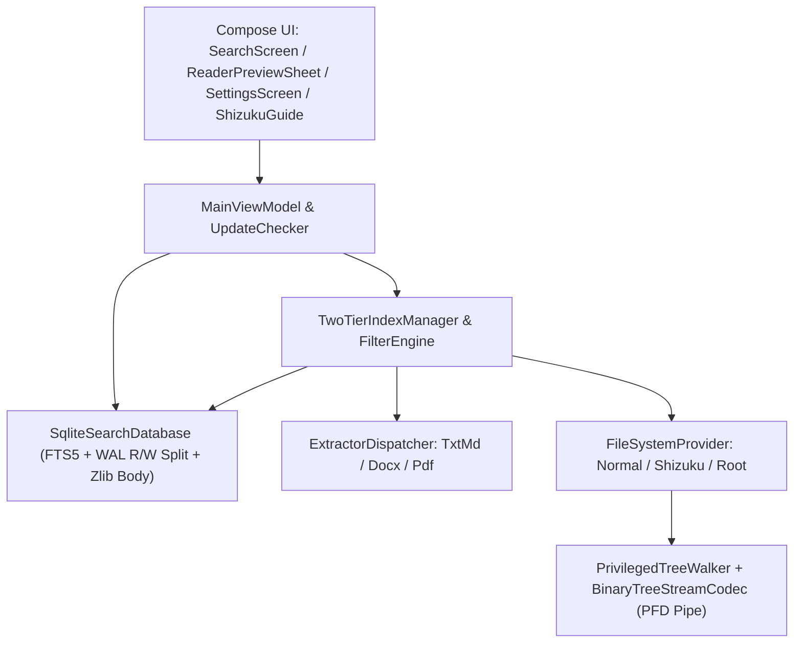

<div align="center">

# Pinpoint

**面向 Android 的离线极速全盘文件与文档正文检索引擎**

对标桌面端 *Everything* 查询语法 · 基于 SQLite FTS5 的任意中文片段毫秒级检索 · 普通 / Shizuku / Root 三级权限接入

<p>
  <a href="https://github.com/yyzmia1/Pinpoint/releases"></a>
  
  
  
</p>

<p>
  <a href="README.md">English</a> · <strong>简体中文</strong>
</p>

</div>

---

## 核心特性

- **完全离线 · 桌面级检索体验**：文件名、路径与文档正文全部在本地完成索引与检索，零网络依赖、无后台上传。
- **任意中文片段毫秒级命中**：采用自研 `CjkTokenizer`（CJK 1-gram / 2-gram 混合分词）结合 AST 严格二次校验，保证单字、跨词中文子串、精确短语、通配符（`*` / `?`）与正则表达式 100% 精准召回、零误报。
- **三级权限全盘接入（`Normal` / `Shizuku` / `Root`）**：
  - **普通模式**：基于 `MANAGE_EXTERNAL_STORAGE` 快速扫描内部与外置公开存储目录。
  - **Shizuku 模式**：免 Root 绑定 `UserService` 穿透 `/Android/data` 与 `/Android/obb`，内置三步式实时检测引导向导。
  - **Root 模式**：通过 `libsu` `RootService` 从 `/` 根目录全盘扫描，基于 POSIX `Os.lstat` 与 `(st_dev, st_ino)` 自动跳过符号链接、虚拟文件系统并消除重复挂载。
- **两级真流式异步建库**：一级路径与元数据通过 `ParcelFileDescriptor` 管道边扫边入库并即时开放搜索，二级队列低并发异步抽取 `.txt` / `.md` / `.docx` / `.pdf` 正文内容，全程恒定批内存占用。
- **全类型 QuickLook 内置预览 (`ReaderPreviewSheet`)**：支持高亮文本/代码/日志预览（自动探测 UTF-8 / BOM / GB18030）、原生 `PdfRenderer` 逐页渲染（覆盖扫描版 PDF）、双指缩放画布切换图片、压缩包目录浏览（`ZIP` / `APK`）、音视频元数据与首帧查看、目录子项钻取及未知二进制文件头十六进制检视。
- **自适应昼夜主题与内置版本更新**：支持跟随系统 / 白天 / 黑夜三态切换与 WCAG 对比度校验；设置页置顶展示版本信息并支持 GitHub Releases 检查更新与 Markdown 更新日志渲染。

---

## 系统架构



### 关键工程设计

| 模块 | 实现要点 |
| :--- | :--- |
| **跨进程流式传输** | 通过 `IPrivilegedFsService` AIDL 配合 `ParcelFileDescriptor` 管道及 `suspend` `BinaryTreeStreamCodec.readStream` 流式消费批次记录，彻底规避 Binder 缓冲区上限与大目录树堆内存峰值。 |
| **挂载点与环路去重** | `PrivilegedTreeWalker` 使用 `File.list()` 减少对象分配，通过 `Os.lstat` 不跟随软链接，并维护 `(st_dev, st_ino)` 集合排除重复 bind/loop 挂载。 |
| **WAL 读写分离连接池** | `SqliteSearchDatabase` 启用 `WAL` 模式并严格隔离 `writeConn` 与 `query_only` `readConn`，后台建库与正文写入不会阻塞前台键入检索。 |
| **目录精准增量清理** | `pruneDirectorySubtree` 采用基于 `path` 唯一索引的 B 树范围查询（`path >= ? AND path < ?`）替代 `LIKE`，规避 `QQfile_recv` 等含 `_`/`%` 目录名通配误删问题。 |
| **正文压缩存储** | 正文经 Zlib（`Deflater` / `Inflater`）压缩后落库 `docs_raw`，命中时按需解压抽取高亮上下文片段。 |
| **跨权限安全唤起** | `FileOpener` 对主存储可读路径直接使用 `FileProvider`，对外置存储次级卷或受限目录自动通过内部 `preview_bridge` 桥接并附加 `ClipData` 读权限。 |

---

## 基准压测表现

基于 `SqliteSearchDatabaseAndBenchmarkTest` 在宿主机 JVM 环境对 **100,000 条文件记录 + 2,000 篇中文文档正文** 的实测延迟：

| 查询类型 | 测试样例 | 实测耗时 |
| :--- | :--- | :--- |
| 中文单字检索 | `税` | **1 ms** |
| 中文双字检索 | `合同` | **5 ms** |
| 跨词任意片段 | `充协议` | **1 ms** |
| 文档正文限定检索 | `content:违约金` | **0 ms** |
| 复合布尔与扩展名过滤 | `(采购 \| 预算) ext:docx -终版` | **23 ms** |

---

## 查询语法速查

由递归下降解析器 `QuerySyntaxParser` 提供完整支持：

| 语法 | 语义说明 | 示例 |
| :--- | :--- | :--- |
| 空格 (`a b`) | 隐式逻辑与 (`AND`) | `合同 2026` |
| `\|` 或大写 `OR` | 逻辑或 (`OR`) | `pdf \| docx` |
| `-` 或 `!` | 逻辑非（排除） | `report -draft` |
| `( ... )` | 分组优先级控制 | `(invoice \| receipt) ext:pdf` |
| `"..."` | 精确短语匹配 | `"补充协议"` |
| `*`, `?` | 严格全串通配符 | `IMG_2026*.jpg` |
| `regex:`、`re:`、`cregex:`、`/pattern/` | 严格正则（`cregex:` / `/pattern/c` 区分大小写） | `/^chapter_\d+\.md$/` |
| `name:`、`path:`、`content:`、`body:` | 限定匹配字段 | `content:违约金` |
| `ext:` | 扩展名过滤（支持 `;` 或 `,` 分隔） | `ext:pdf;docx` |
| `type:` | 类型限定（`file` / `folder`） | `type:folder cache` |
| `size:` | 文件大小区间（`b` / `kb` / `mb` / `gb`） | `size:>10mb` |
| `dm:` | 修改日期 / 相对时间窗口 | `dm:today` / `dm:7d` |

---

## 技术栈与工程结构

| 类别 | 选型与版本（见 `gradle/libs.versions.toml`） |
| :--- | :--- |
| **语言与构建** | Kotlin `2.1.0` · AGP `8.8.0` · JDK `17` · `compileSdk 35` / `minSdk 26` |
| **UI 框架** | Jetpack Compose（`2025.02.00` BOM）· Material 3 · 自适应昼夜主题 |
| **存储与检索引擎** | `androidx.sqlite:sqlite-bundled:2.6.2`（SQLite FTS5 + WAL） |
| **后台调度与特权 IPC** | `WorkManager 2.10.0` · `libsu 6.0.0` · `dev.rikka.shizuku 13.1.5` · Coroutines `1.10.1` |
| **文档与编码解析** | `PDFBox-Android 2.0.27.0` · 流式 `ZipInputStream` + SAX · 智能 BOM/GB18030 编码识别 |

<details>
<summary>展开查看源码目录结构</summary>

```text
.
├── .github/workflows/ci-build-release.yml   # 手动触发 CI 与 nightly 测试预发布流水线
├── gradle/libs.versions.toml                # 统一依赖版本清单
├── settings.gradle.kts                      # rootProject.name = "Pinpoint"
├── README.md                                # 英文工程文档
├── README.zh-CN.md                          # 简体中文工程文档
└── app/
    ├── src/main/
    │   ├── aidl/com/pocketeverything/app/ipc/IPrivilegedFsService.aidl
    │   ├── java/com/pocketeverything/app/
    │   │   ├── data/        # SettingsRepository（设置持久化）, UpdateChecker（版本检测）
    │   │   ├── di/          # AppContainer（依赖容器）
    │   │   ├── filter/      # FilterConfig, FilterEngine（目录过滤与白名单策略）
    │   │   ├── fs/          # PrivilegedTreeWalker, Root/Shizuku 服务, BinaryTreeStreamCodec, FileOpener
    │   │   ├── indexer/     # TwoTierIndexManager, IncrementalSyncWorker, RealtimeMonitorService, BootReceiver
    │   │   ├── parser/      # ExtractorDispatcher, TxtMdExtractor, DocxExtractor, PdfExtractor
    │   │   ├── search/      # QuerySyntaxParser, SearchQueryAst, CjkTokenizer, SqliteSearchDatabase, SnippetHighlighter
    │   │   └── ui/          # SearchScreen, SettingsScreen, ShizukuGuideScreen, ReaderPreviewSheet, FormatUtils
    │   └── res/             # 自适应单色桌面图标、字符串资源、FileProvider 路径配置
    └── src/test/java/com/pocketeverything/app/
        ├── BinaryTreeStreamCodecTest.kt
        ├── CjkTokenizerTest.kt
        ├── DocumentExtractorTest.kt
        ├── FilePreviewLoaderTest.kt
        ├── FilterEngineTest.kt
        ├── FormatUtilsTest.kt
        ├── QuerySyntaxParserTest.kt
        ├── SnippetHighlighterTest.kt
        ├── SqliteSearchDatabaseAndBenchmarkTest.kt
        ├── ThemeContrastTest.kt
        └── UpdateCheckerTest.kt
```

</details>

---

## 构建、验证与 CI

### 环境准备

- JDK 17 或 JDK 21
- Android SDK Platform 35（`compileSdk = 35`，`minSdk = 26`）
- 在项目根目录配置 `local.properties`（`sdk.dir=/path/to/Android/Sdk`）

### 本地构建与检测命令

```bash
# 运行全部 JVM 单元测试与 Android Lint 静态检查
./gradlew :app:testDebugUnitTest :app:lintDebug --console=plain

# 编译 Debug 测试包（包名 com.yyzm.pinpoint.debug，可与正式版并存安装）
./gradlew :app:assembleDebug --console=plain

# 编译开启 R8 混淆裁剪的 Release 正式包（包名 com.yyzm.pinpoint）
./gradlew :app:assembleRelease --console=plain
```

### CI 与发布签名配置

- [ci-build-release.yml](.github/workflows/ci-build-release.yml) 设为 `workflow_dispatch` 手动按需触发，避免日常推送阻塞云端构建队列。
- 如需在 GitHub Actions 中使用正式签名证书签发测试包，可在仓库 Secrets 中配置：`RELEASE_KEYSTORE_BASE64`、`POCKET_KEYSTORE_PASS`、`POCKET_KEY_ALIAS`、`POCKET_KEY_PASS`。

---

> [!IMPORTANT]
> **包名迁移提示（`v1.2.2+`）**：自 `v1.2.2` 起正式包名变更为 `com.yyzm.pinpoint`（仓库由 `PocketEverything` 更名为 `Pinpoint`）。更早版本（`<= v1.2.1`）使用 `com.pocketeverything.app`，Android 会将两者视为独立应用；安装 `v1.2.2+` 前请先手动卸载旧包 `com.pocketeverything.app`，以免桌面出现重复图标。
